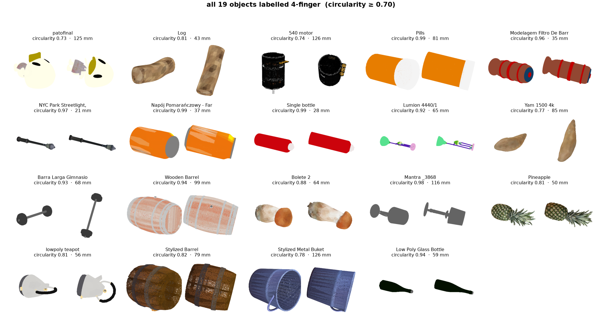

# Stage 1 — which gripper

**object image + `gripper/gripper_description.md` → LLM → 2-finger or 4-finger**

Qwen3-VL-2B-Instruct-4bit, running locally through MLX. It sees a render of the object
and the gripper description, and returns one configuration plus a one-line reason.

| notebook | what it does |
|---|---|
| `stage1_gripper.ipynb` | the decision on 10 Objaverse objects, then hands each choice to stage 2 to see whether it worked |
| `finetune_selector.ipynb` | labelling 100 objects and LoRA fine-tuning the selector on them |

## The result

**The model answers the same gripper for every object.** In the 10-object run it said
`2-finger` ten times out of ten. Asked again with the two options listed in the opposite
order, same answer — so it is a settled preference, not a formatting artefact.

Fine-tuning did not fix it:

| | accuracy | 2-finger recall | 4-finger recall | answered 4-finger |
|---|---|---|---|---|
| zero-shot | 94.1% | 98% (n=65) | **0%** (n=3) | 1 / 68 |
| fine-tuned | 95.6% | 100% (n=65) | **0%** (n=3) | **0 / 68** |

Accuracy went up while the model got worse at the thing it was trained for. Round objects
are about one in five, so answering `2-finger` every time scores 96% — accuracy is the
wrong number to read here, per-class recall is.

**What it did learn is the explanation.** All 68 answers quote a circularity value in the
exact phrasing of the training labels. Those values correlate with the real measurement at
**r = −0.04** — no relationship — with a mean error of 0.18 on a 0–1 scale. It told us a
mushroom with circularity 0.88 had 0.26. The justification is the right shape with a
fabricated number in the evidence slot.

## Is it the model?

No. SmolVLM2-500M — the frozen VLM backbone inside **SmolVLA** — fails the same way on the
same held-out set, just in the opposite direction:

| model | accuracy | 2-finger recall | 4-finger recall | what it answered |
|---|---|---|---|---|
| Qwen3-VL-2B, zero-shot | 94.1% | 98% | **0%** | `2-finger` 67 / 68 |
| Qwen3-VL-2B, fine-tuned | 95.6% | 100% | **0%** | `2-finger` 68 / 68 |
| SmolVLM2-500M, zero-shot | 4.4% | **0%** | 100% | `4-finger` 68 / 68 |

Two different models, two different sizes, both constant — one always says 2-finger, the
other always says 4-finger. Neither is reading the object. **The bottleneck is the task as
posed, not the model.** The label is cross-section circularity, a 3D property measured from
the mesh, and two fixed renders may simply not carry it.

The cheap fix is to stop asking a VLM to measure: circularity takes milliseconds from the
point cloud we already build for stage 2, and a one-line threshold does it exactly. The VLM's
job would then be the part it might actually be good at — the cases geometry gets wrong.



*All 19 of the 100 objects labelled 4-finger.*

## The labels

There is no ground truth for this on Objaverse — no simulator we can run, no physical
trials on 100 artist meshes. The labels are ours, from one measured criterion: how circular
the cross-section is across the object's long axis. A circle scores 1.0, a square 0.71, a
flat slab near 0; the threshold is 0.70. A 2-finger pinch needs two opposing flats, and
round cross-sections have none.

An earlier version of the rule had a second "bulky in every direction" branch from
bounding-box ratios. Rendering everything it had labelled 4-finger showed it flagging a
table top (circularity 0.14), a telephone (0.26) and a dumpster — flat panels with the best
pinching faces in the set. Bounding-box ratios mislead on hollow meshes. That branch is gone.

So this measures whether Qwen can learn *our rule*, not whether it picks grippers well.

## Files

```
adapters/                      the fine-tuned LoRA (8.7 M params, 0.41% of the model)
results/demo/                  the 10-object run: renders, thumbnails, picks, figure
results/labels/                the 100 labels, the train/valid/test split, both evaluations
```
