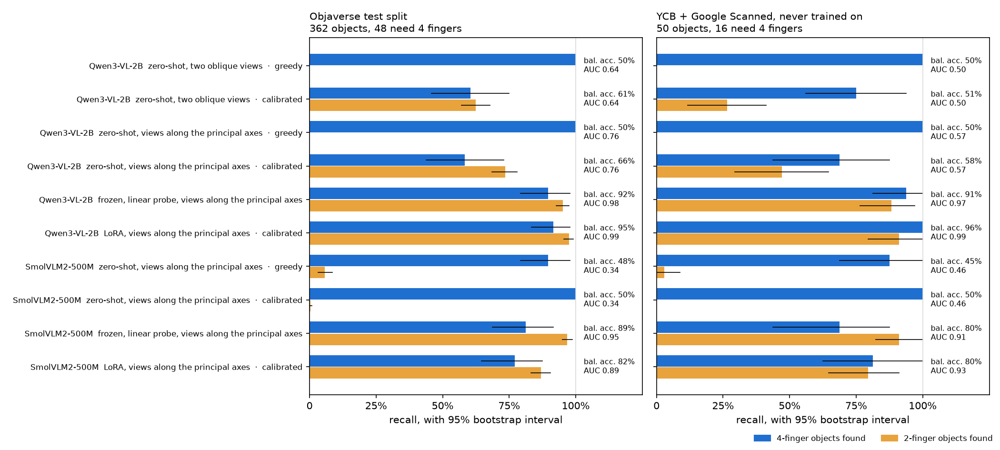
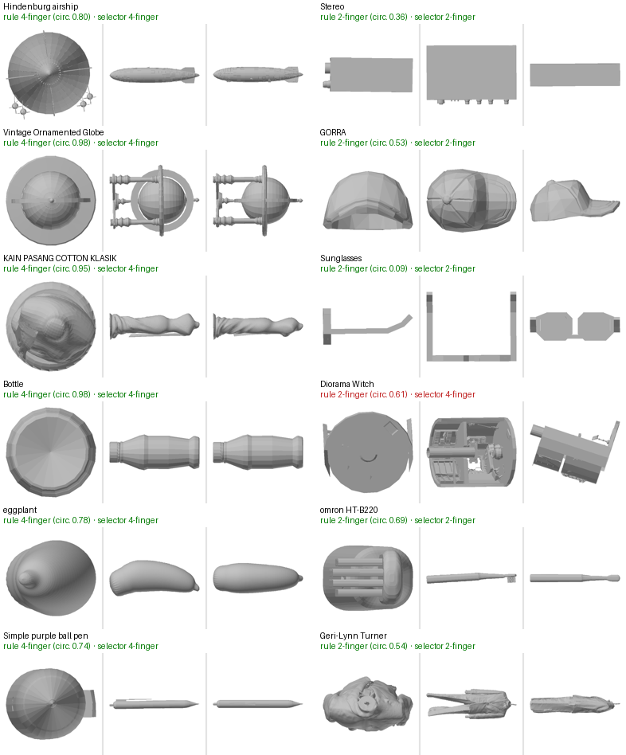

# Stage 1 — which gripper

**object views → VLM → 2-finger or 4-finger**

Qwen3-VL-2B-Instruct-4bit, running locally through MLX, decides whether our fin-ray gripper should
close two fingers or four on an object. The first version of this stage looked like it worked
(95.6% accuracy) and decided nothing: it gave the same answer for every object. This README covers
why that happened and how it was fixed.

| Qwen3-VL-2B, fine-tuned | balanced accuracy | 4-finger recall | 2-finger recall | test objects (4-finger) |
|---|---|---|---|---|
| **before**: answer parsed from generated text | 50% | 0% (0 of 3) | 100% | 68 (3) |
| **after**: answer read from the logits | **94.6%** [90.4, 98.0] | **91.7%** (44 of 48) | 97.5% | 362 (48) |
| after, real-scanned objects never trained on | **95.6%** [89.7, 100] | **100%** (16 of 16) | 91.2% | 50 (16) |

*Brackets: 95% bootstrap interval. Accuracy is 96.7% on the test split, but it is no longer the
number to read: a constant answer would still score 87%.*



## What went wrong

The first version labelled 100 Objaverse objects, fine-tuned on 26 of them and tested on 68.
Both the zero-shot and the fine-tuned model answered `2-finger` for every test object.
SmolVLM2, the VLM inside SmolVLA, answered `4-finger` for every one. Accuracy was high only
because 3 of the 68 need four fingers.

The fine-tuned model also explained itself with a circularity value in the phrasing of the
training labels. That value had no relationship to the real one (r = −0.04).

Four things caused it:

1. **The answer was parsed from generated text.** Greedy decoding reports only the model's top
   token. A small VLM choosing between labels leans toward one of them whatever the input: the
   majority-label bias of LLM classifiers (Zhao et al. 2021, *Calibrate before use*). The logits
   still carry the decision. With this README's prompt, zero-shot Qwen says `4-finger` for 100%
   of objects, yet logit("4") − logit("2") ranks them with AUC 0.76.
2. **The training target was mostly an explanation.** One token chose the gripper. Thirty more
   held a reason containing a number the model cannot see in the image, so most of the loss went
   to the reason.
3. **The data could not support it.** There were 26 training examples and 3 four-finger test
   objects. 0 of 3 has a 95% interval of 0–71%, so the old recall measured almost nothing.
4. **The images did not show the property.** The label is the circularity of the cross-section
   across the object's long axis. Two fixed oblique views often never look down that axis.

## The fix

| | before | after |
|---|---|---|
| objects | 100 Objaverse (26 train, 68 test) | 1,726 Objaverse + 50 real-scanned; 1,496 kept |
| test sets | 68 objects, 3 need 4 fingers | 362 objects, 48 need 4 fingers; plus 50 real-scanned, 16 need 4 |
| images | two oblique colour renders | three grey orthographic views along the principal axes; the left one looks down the long axis |
| target | `gripper: X` + a reason with a number | the gripper token only |
| loss | cross-entropy over every answer token | two-way cross-entropy over "2" / "4", weighted 0.57 / 3.84 by inverse class frequency |
| decision | parse the generated text | logit("4") − logit("2") above a threshold set on the validation split |

- **More objects, same rule.**
  - `download_objaverse.py` adds 1,500 objects from GraspGen's Objaverse subset, which carries
    real-world scale factors.
  - `build_selector_dataset.py` labels every object with the unchanged rule
    (`label_geometry.py`). It drops 280 that are wider than the gripper opens.
  - Splits are stratified by label, 60/15/25 train/validation/test, seed 0.
  - The 26 YCB and 24 Google Scanned Objects form a second test set: real scans, never trained on.
- **Images that show the cross-section.** `views.py` renders each object along its principal
  axes, computed exactly as the labeller computes them. Every object is grey and flat-shaded, so
  neither the textures of artist meshes nor their absence on scans is a cue.
- **The decision read from the logits.** `vlm_selector.py score` does one forward pass per object
  and reads the two answer logits. The threshold is the one that maximises balanced accuracy on
  the validation split; the test and external numbers never touch it.
- **Training aimed at the decision.** `vlm_selector.py train` uses:
  - LoRA rank 8 on the language model (8.7 M parameters);
  - a loss restricted to the two answer tokens, weighted so the rare class carries half of it;
  - mirrored panels as augmentation;
  - 2 epochs, keeping the epoch with the best validation AUC (epoch 2: AUC 0.993).

## Results

| Qwen3-VL-2B | decision | balanced acc. | 4-finger recall | 2-finger recall | AUC | says 4-finger |
|---|---|---|---|---|---|---|
| zero-shot | greedy | 50% | 100% | 0% | 0.76 | 100% |
| zero-shot | calibrated threshold | 66% | 58% | 74% | 0.76 | 31% |
| frozen + linear probe | calibrated threshold | 92% | 90% | 95% | 0.98 | 16% |
| **LoRA, two-token loss** | **calibrated threshold** | **95%** | **92%** | **97%** | **0.99** | 14% |

*Objaverse test split, 362 objects, 13% of them 4-finger. All runs use the axis views. Every number
with its interval, and the real-scanned set, is in `results/selector/metrics.csv`.*

**Is it the model or the readout?** A linear probe on the frozen model already reaches 92%
balanced accuracy, and 91% on the real scans. The probe is a balanced logistic regression on the
hidden state at the answer position. So the image features carried the decision all along; what
failed was getting it out through generated text. Zhang et al. 2024 (*Why are visually-grounded
language models bad at image classification?*) report the same pattern. Fine-tuning the readout
with the right loss gets the last few points and makes the generated answer itself correct: at
threshold 0, with no calibration, the LoRA model scores 92.6%.

**Where it is still wrong.** It makes 12 errors on the test split and 3 on the real scans.
- 8 of those 15 are objects whose circularity is within 0.07 of the rule's 0.70 threshold. All 3
  errors on the scans are at 0.68–0.69: a flower pot, the bleach bottle and the foam brick.
- Two of the clear misses are the rule's mistakes, not the selector's:
  - A fridge poster is a flat sheet of zero thickness, yet it scores 0.99. Its cross-section is a
    line, so only 2 of the rule's 24 angle bins hold any points, and the ratio of those two radii
    is about 1. The selector says 2-finger, which is right. 4 of the 205 four-finger labels are
    flat sheets like this.
  - A cartoon cucumber is round, but its eyes stick out, and circularity is min/max radius, so it
    scores 0.27. The selector says 4-finger.
  - Fix for the rule: count empty angle bins as radius 0, and take a percentile instead of the
    minimum. It is not applied here, because changing labels after seeing results would flatter
    them.

**Does it carry over to SmolVLA's VLM?**
- SmolVLM2-500M, the frozen VLM inside SmolVLA, fails worse zero-shot. It says `4-finger` for 94%
  of objects, and its logits rank them backwards (AUC 0.34), so no threshold rescues it.
- A linear probe on its frozen hidden state still reaches 89% balanced accuracy, and 80% on the
  real scans. The features carry the decision here too.
- The same LoRA recipe takes it from 48% to 82%, and to 80% on the scans. After two epochs its
  loss is still near chance, so it is undertrained: more epochs, or its probe, would do better.

**Did the views matter?** With two oblique views instead, the probe on frozen Qwen drops from 92%
to 86% on the test split, and from 91% to 69% on the real scans. Zero-shot AUC drops from 0.76 to
0.64. Looking down the long axis is what makes the label visible, most of all on real objects.



*Test objects as the selector sees them, with the rule's label and the selector's pick. Green
means they agree.*

## The labels

There is no ground truth for this on Objaverse: no simulator we can run, and no physical trials on
artist meshes. The labels are ours, from one measured criterion: how circular the cross-section is
across the object's long axis.
- A circle scores 1.0, a square 0.71, a flat slab near 0. The threshold is 0.70.
- A 2-finger pinch needs two opposing flats, and round cross-sections have none.

An earlier version of the rule had a second "bulky in every direction" branch built from
bounding-box ratios. It flagged a table top (circularity 0.14), a telephone (0.26) and a dumpster:
flat panels with the best pinching faces in the set. That branch was removed.
`results/labels/labels_all.json` still holds that version's labels; 9 of its objects disagree with
the current rule. The new dataset relabels everything with the current rule.

So this measures whether the VLM learns *our rule*, not whether it picks grippers well. Stage 2
checks the other half: whether the picked gripper can actually be planned and closed on the object.
It also finds the rule's main blind spot: squat round objects like a ramekin. Their cross-section
across the long axis is a flat rectangle, so the rule says 2-finger, but only four fingers close
on them.

## Files and commands

```
scripts/download_objaverse.py       1,500 more Objaverse meshes into data/objaverse/meshes (6 GB, not tracked)
scripts/build_selector_dataset.py   labels, renders (data/selector/, not tracked), splits -> results/selector/objects.csv
scripts/views.py                    the renderer: views along the principal axes, or two oblique views
scripts/vlm_selector.py             score (logits + hidden state per object) and train (LoRA, two-token loss)
scripts/selector_report.py          metrics with bootstrap intervals, the linear probe, both figures
adapters/selector_axis/             the fine-tuned Qwen selector: config and training log (weights not tracked)
adapters/selector_smol_axis/        the same for SmolVLM2
results/selector/                   objects.csv, scores_*.csv, metrics.csv, the figures
finetune_selector.ipynb, stage1_gripper.ipynb, results/labels/, results/demo/   the first version
```

```bash
G=/opt/anaconda3/envs/graspgenx/bin/python;  M=/opt/anaconda3/envs/mlxvlm/bin/python
$G stage1_gripper/scripts/download_objaverse.py 1500
$G stage1_gripper/scripts/build_selector_dataset.py                                    # ~30 min
$M stage1_gripper/scripts/vlm_selector.py score --layout axis --tag axis_zeroshot       # ~20 min
$M stage1_gripper/scripts/vlm_selector.py train --layout axis --epochs 2 --out stage1_gripper/adapters/selector_axis   # ~55 min
$M stage1_gripper/scripts/vlm_selector.py score --layout axis --adapter stage1_gripper/adapters/selector_axis \
       --tag axis_lora --splits valid,test,external
$M stage1_gripper/scripts/vlm_selector.py score --layout fixed --tag fixed_zeroshot     # the oblique views
S=mlx-community/SmolVLM2-500M-Video-Instruct-mlx                                       # SmolVLA's VLM
$M stage1_gripper/scripts/vlm_selector.py score --layout axis --model $S --tag smol_axis_zeroshot
$M stage1_gripper/scripts/vlm_selector.py train --layout axis --model $S --epochs 2 --out stage1_gripper/adapters/selector_smol_axis
$M stage1_gripper/scripts/vlm_selector.py score --layout axis --model $S --adapter stage1_gripper/adapters/selector_smol_axis \
       --tag smol_axis_lora --splits valid,test,external
$G stage1_gripper/scripts/selector_report.py
```

Training runs one example at a time (about 5 GB). Batches of 4 peak at 14 GB on this 16 GB Mac.
