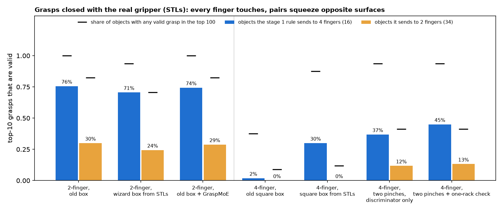
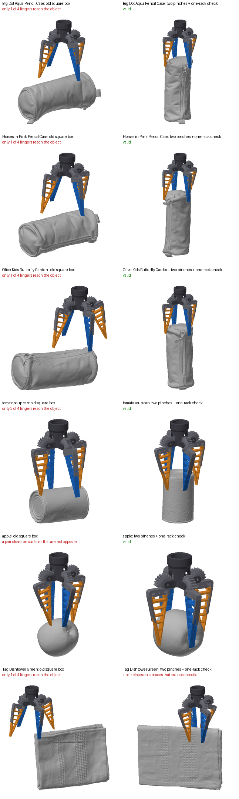
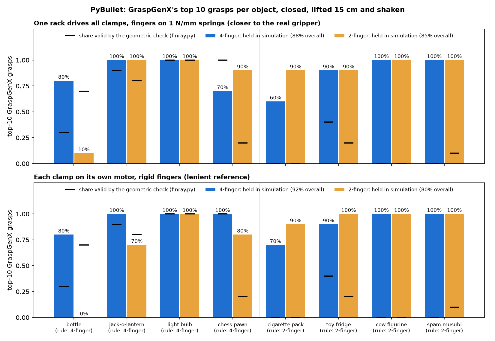
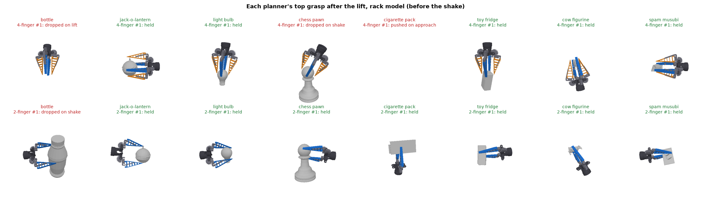

# Stage 2 — where to grasp

**object point cloud + chosen gripper → GraspGenX → 6-DOF grasps → checked with the real gripper**

GraspGenX tells its model about a gripper through **twelve numbers**: the box swept between the
fingers when open and half-open. The first version of this stage did three things:
- gave it a 2-finger box and a square 4-finger box;
- measured "standoff": whether the object crosses the top of the box;
- found the 2-finger grasps reached the object and the 4-finger ones never did.

This README covers what was wrong with that, and the fix.

| | before (standoff, old box) | after (grasps closed with the real fingers) |
|---|---|---|
| 4-finger, on objects stage 1 sends to 4 fingers | 0% reach (10 Objaverse objects), 18% (10 YCB) | **45%** of top-10 grasps valid, **15 of 16** objects with a valid grasp |
| the same objects, the old 4-finger box | | 2% valid, 6 of 16 |
| 2-finger | 84% reach (10 Objaverse), 68% (10 YCB) | 76% valid on round objects, 30% on the rest; 44 of 50 objects with a valid grasp |

*The "84% vs 0%" quoted before came from the 10 Objaverse demo objects in stage 1. On the 10 YCB
objects the same metric gave 68% vs 18%.*



## What was wrong

1. **A box cannot say "four fingers".**
   - The released checkpoint conditions on the twelve numbers alone
     (`gripper_backbone: sweep_volume_v2`); the gripper type is not an input.
   - Every gripper it was trained on (parallel and revolute 2-finger, revolute 3-finger) closes
     along one axis. Between open and half-open its box narrows in x and keeps its y.
   - Our 4-finger box narrows in both: a gripper the model has never seen.
2. **The numbers did not match the gripper.**
   - `params_legacy.json` says the fingers sweep a 148 × 30 × 38 mm box.
   - Assembled from the STLs and opened until the fingertips are 148 mm apart, the fingers form a
     V instead: 66 mm apart at the root, 148 mm only at the tips. The tips reach 26 mm past the top
     of the box, and the fingers are 10 mm thick, not 30.
   - A 148 × 148 mm square reads as a huge hand, and the model backs off. The square box measured
     from the STLs (66 × 66 mm open) already does far better: 30% valid instead of 2%.
3. **The metric was the box's, not the gripper's.** Standoff only asked whether the object crossed
   the top of that box. It never asked whether a finger touches the object, whether the gripper
   collides with it, or whether the pinch can hold.

## The fix

**Check every grasp with the real gripper** (`finray.py`). The body, clamps and fingers are
assembled from the STLs (`assemble_gripper.py`). They are closed on the object one clamp-angle
step at a time, with FCL collision checks. A grasp is valid only if:
- nothing collides when fully open;
- every finger touches the object with its finger, not its clamp, before the fingers meet;
- with four fingers, the two pairs grip close enough together. All clamps turn off one rack, so
  the pair that grips first keeps being driven until the other grips. That extra travel must fit
  in the fin-ray's bending: 10 mm at the contact. The fin-ray sensing paper in `papers/` loads a
  finger of this size to 10 mm.
- each opposing pair squeezes along its contact line: the line between the two contacts lies
  inside both friction cones (μ = 0.6). Normals are averaged over the 5 mm patch a fin-ray presses.

**Plan four fingers as two pinches** (`four_finger.py`).
- Our 4-finger gripper is two of our 2-finger grippers on one approach axis, the second turned 90°.
  So a 4-finger grasp at pose T is good when the 2-finger grasp at T holds and so does the one at T
  turned 90°.
- GraspGenX's discriminator, given the 2-finger box it does understand, scores both pinches; the
  weaker one decides.
- Candidates come from GraspGenX itself: its default planner with the 2-finger box (diffusion
  samples plus its bounding-box sweep), and its grasps for the STL-sized square box. Each is turned
  0–75° about its approach axis in 15° steps.
- What the discriminator cannot know is that one rack drives both pairs. So the object must be
  about as wide under one pair as under the other, measured from the point cloud. The two widths
  may differ by at most 2 × 10 mm.
- Without this check, the planner pinches a soup can across its diameter with one pair and end to
  end with the other. That scored 0% on the soup can; with the check, 80%.

**Choose the 2-finger box by what it produces** (`tune_gripper_box.py`).
- No single box fits a V, so the box is treated as a description to calibrate.
- Eleven candidates (66–148 mm wide; the fingertip band or the whole finger; the old box among
  them) each planned grasps on 16 Objaverse objects from stage 1's training split.
- A candidate would replace the old box only if it beat it on the same objects (paired Wilcoxon,
  p < 0.05).
- None did. The best, essentially the wizard's 66 mm box, scored 0.21 against the old box's 0.19
  (p = 0.38). So the old box stays, and the 4-finger planner uses it too.

## Results

50 real-scanned objects: 26 YCB and 24 Google Scanned Objects, the same ones stage 1 is tested on.
For each method, the 10 grasps it scores highest are closed with the real fingers. Planning takes
about 1 s per object for 2 fingers and 2 s for 4, on the Mac CPU.

| method | stage 1 sends to 4 fingers (16 objects): top-10 valid | top-1 valid | any valid in top 100 | sends to 2 fingers (34): top-10 valid | any valid in top 100 |
|---|---|---|---|---|---|
| 2-finger, old box | 76% | 81% | 16 | 30% | 28 |
| 2-finger, wizard box from the STLs | 71% | 69% | 15 | 24% | 24 |
| 2-finger, old box + GraspMoE | 74% | 81% | 16 | 29% | 28 |
| 4-finger, old square box | 2% | 0% | 6 | 0% | 3 |
| 4-finger, square box from the STLs | 30% | 31% | 14 | 0% | 4 |
| 4-finger, two pinches, discriminator only | 37% | 44% | 15 | 12% | 14 |
| **4-finger, two pinches + one-rack check** | **45%** | **50%** | **15** | 13% | 14 |



*The best-scored 4-finger grasp, old square box (left) and the fixed planner (right), drawn with
the STLs. Each finger is closed to where it first touches. Each panel is drawn from the gripper's
side, so the object's orientation differs between panels.*

**What the results show.**
- **The fixed planner cages round objects as the gripper was designed to.** It approaches a
  cylinder along its axis and closes four fingers around the round cross-section. The old box
  approached from the side and stopped short. The only object stage 1 sends to 4 fingers that gets
  no valid 4-finger grasp is the 19 mm marker.
- **Four fingers also work on squat round objects the rule sends to two.** Examples: the ramekin
  (90%), the tuna can (100%), the coffee mug (90%) and the mug (70%). Their cross-section across
  the long axis is a flat rectangle, so the rule says 2-finger; seen from above they are circles.
  This is the rule's main blind spot.
- **The 2-finger gripper validly closes on round objects too** (76% of top-10 grasps). The
  geometric check cannot say whether two fingers would let a round object roll. That is the reason
  for the 4-finger configuration, and it is a stability question for physical trials or
  simulation.
- **Six objects get no valid 2-finger grasp:** the frying pan and five bowls. They are wider than
  the 148 mm opening, so a grasp has to pinch the thin rim wall, and on these grasps only one
  finger reaches it.
- **GraspMoE adds nothing for 2 fingers here.** It is GraspGenX's default planner (diffusion plus
  a bounding-box sweep), and it matches plain diffusion: 74% vs 76%.

## The whole pipeline

Stage 1's fine-tuned selector picks the gripper, and stage 2 plans it (`pipeline_check.py`). An
object is handled when the grasp the pipeline executes is valid: either the planner's top grasp,
or the best-scored valid grasp in its top 100 when `finray.py` is used as a filter.

| policy, 50 real-scanned objects | top grasp valid | filtered | picks 4-finger |
|---|---|---|---|
| old pipeline: the VLM always said 2-finger | 50% | 88% | 0% |
| old planners, with stage 1's rule picking correctly | 24% | 68% | 32% |
| **fixed selector + fixed planners** | **40%** | **86%** | 38% |
| always 4 fingers, fixed planner | 26% | 58% | 100% |

The old pipeline looked healthy only because its VLM never chose 4 fingers. A selector that did
choose them would have dropped it to 68%, because the old 4-finger planner failed on everything
sent to it. With both stages fixed, sending 38% of objects to four fingers costs almost nothing
geometrically (86% vs 88%). Whether those grasps hold better is the stability question above.

## Physics simulation

GraspGenX's own simulation extra is CUDA-only, so the grasps were also run in PyBullet on the Mac
(`sim_plan.py`, `sim_gripper_urdf.py`, `sim_grasps.py`). There are 8 Objaverse objects from stage 1's
test split, all narrower than the 148 mm opening. The rule sends 4 of them to 4 fingers (bottle,
jack-o-lantern, light bulb, chess pawn) and 4 to 2 fingers (cigarette pack, toy fridge, cow figurine,
spam musubi). Each planner's 10 top-scored grasps are simulated in its order: the fixed 4-finger
planner, then GraspGenX's 2-finger grasps on the same objects.

**Protocol.** It is ACRONYM-style, with no table, because the planners model none.
1. The object floats with gravity off.
2. The gripper starts open, 10 cm back along its approach, and moves in. Pushing the object more
   than 15 mm counts as a collision.
3. The fingers close.
4. Gravity comes on along the object's down. The gripper lifts 15 cm, holds, then shakes ±3 cm at
   2 Hz.

A grasp is held if the object still touches the gripper and has drifted less than 3 cm in its frame.

**The gripper.** The URDF is built from the STLs with the same assembly as `finray.py`. Its
fingertips match `finray.py` to 0.0000 mm at three clamp angles. In the main model, one rack drives
all clamps:
- the clamps follow one shared angle;
- the drive is torque-limited at 2.4 N m in total, so each of the 2-finger gripper's two fingers
  gets twice the share of each of the 4-finger gripper's four;
- each finger rides a 1 N/mm spring slide (20 mm travel) along its contact beam's normal, which
  stands in for the fin-ray's give.

A lenient reference model gives each clamp its own 0.6 N m motor and uses rigid fingers.

| 10 top grasps per object, held | 4-finger | 2-finger |
|---|---|---|
| **one rack + springs**, all 8 objects | **88%** (70/80) | **85%** (68/80) |
| the 4 the rule sends to 4 fingers | **88%** | 75% |
| the 4 the rule sends to 2 fingers | 88% | **95%** |
| bottle, 0.5 kg, the heaviest | **8/10** | 1/10 |
| independent motors, rigid fingers, all 8 | 92% | 80% |





Videos of each planner's #1 grasp are in `results/sim_videos/`:
- `<object>.mp4`: 4-finger on the left, 2-finger on the right;
- `all.mp4`: all 16 runs.

They show the whole sequence at real time, with the same physics as the table: all 16 outcomes match
`sim_grasps.csv`. The repo's `*.mp4` rule in `.gitignore` keeps them out of git.

**What the simulation shows.**
- **Four fingers matter when the object is heavy and round.** The 0.5 kg bottle stays in 8 of the
  10 four-finger grasps but only 1 of the 10 two-finger ones. Of the other nine two-finger grasps:
  - 4 squeeze it out of the fingers' V as they close (both fingers touch it, then it slips out);
  - 3 hit it on the way in;
  - 2 drop it in the shake.

  On the flat-sided objects, the 2-finger grasps do slightly better (95% vs 88%), which is the split
  stage 1 makes.
- **Light objects are held almost regardless of grasp.** Six of the 8 objects weigh under 0.1 kg,
  and 3 sit at the 0.05 kg floor. Against ~8–16 N of grip, almost any contact holds their weight.
  So most of the per-object bars are 90–100%.
- **The geometric check and the simulation mostly disagree.** In the rack model:
  - of the grasps `finray.py` calls valid, 92% (4-finger) and 80% (2-finger) are held;
  - of the grasps it rejects, 84% and 88% are held too;
  - overall agreement is 50% and 38%.

  There are four reasons, all of them leniencies of the simulation or strictness of the check:
  - the floating object slides to centre between the closing fingers, whereas the check assumes
    it stays put, so "only 1 of 2 fingers reach" grasps often hold;
  - the check tests opposition at the first-contact points, while in simulation the fingers keep
    squeezing until the object settles;
  - the objects are light;
  - contacts are rigid points.

  The check is a conservative filter, not a predictor of holding in this setup.
- **The rack model costs the 4-finger gripper little.** Held 4-finger grasps compress the finger
  springs by a median of 8 mm (13 mm for 2-finger), within the 10–20 mm a fin-ray gives. One
  bottoms out at 20 mm.
- **The totals are stable; single objects are not.** Closing at 0.3 rad/s instead of 1 rad/s gives
  the same overall rates: 88% for 4-finger and 85% for 2-finger in the rack model. A single object
  can move by up to 3 of its 10 grasps, though (the pawn's 4-finger grasps go from 7 to 10, the
  cigarette pack's from 6 to 4). Read the per-object bars as ±2–3 grasps.
- **Rigid V-shaped fingers squeeze large objects out.** Pinched near the tips, a floating object
  slides out of the open V as the fingers close. A real fin-ray wraps around it instead; that is the
  Fin Ray effect. So the simulation is harsh on fingertip grasps of large objects, such as the
  bottle's two-finger grasps, and lenient on most others.

**Not modelled.** These are the approximations:
- the fin-ray's bending and wrapping (fingers are rigid on a straight spring slide);
- the real drive torque (2.4 N m is assumed);
- the object's true mass: 400 kg/m³ × the convex-hull volume, clamped to 0.05–0.5 kg, because
  Objaverse meshes are rarely watertight;
- a table;
- gravity is off until the lift.

Friction is 0.6 at the fingers. Collisions use convex decomposition (`p.vhacd`) for the object, body
and clamp, and the convex hull for each finger. All 320 trials run in about 50 s on the M4's CPU.

## Caveats

- **Geometry, then rigid-body physics.** The check has no object weight, no table, and no
  deformation beyond the bending allowance. The PyBullet run above adds weight, friction and a
  shake, but with rigid fingers, a floating object and assumed masses. Neither proves a grasp holds
  on the real gripper.
- **The opening angle is assumed.** The rack is not among the STLs, so the gripper is opened until
  the fingertips are 148 mm apart, the aperture the old box gave GraspGenX.
- **The 4-finger planner inherits the 2-finger model's blind spots.** It reuses GraspGenX's
  discriminator twice. It adds no knowledge of four fingers beyond the 90° composition, the
  one-rack width check and the final check.
- **16 objects need four fingers by the rule.** The interval on any 4-finger percentage here is
  wide (±20–25 points).

## Files and commands

```
scripts/finray.py              the gripper from the STLs, and the grasp check
scripts/four_finger.py         4-finger grasps as two 2-finger pinches, with the one-rack check
scripts/tune_gripper_box.py    choose the 2-finger box -> data/gripper/params_tuned.json, results/gripper_box_tuning.csv
scripts/evaluate_grasps.py     every method on the 50 objects -> results/grasp_check.csv (poses in data/grasp_eval/)
scripts/plot_grasps.py         results/grasp_check.png, results/grasp_check_4f.png
scripts/pipeline_check.py      stage 1's pick + stage 2's plan -> results/pipeline_check.csv
scripts/objects.py             YCB, Google Scanned and Objaverse meshes in metres
scripts/sim_plan.py            GraspGenX grasps for the simulation, both grippers -> data/sim/
scripts/sim_gripper_urdf.py    PyBullet URDFs of the gripper from the STLs -> data/sim/gripper/
scripts/sim_grasps.py          the PyBullet runs -> results/sim_grasps.csv, sim_grasps.png, sim_snapshots.png
scripts/sim_videos.py          each object's #1 grasp, 4- vs 2-finger, as video -> results/sim_videos/*.mp4
results/gripper_boxes.json     the old boxes and the ones measured from the STLs
stage2_grasp.ipynb, stage2_grasp_4finger.ipynb, scripts/graspgenx_selected_objects.py   the first version
```

```bash
G=/opt/anaconda3/envs/graspgenx/bin/python
$G stage2_grasp/scripts/tune_gripper_box.py       # ~40 min, resumes if stopped
$G stage2_grasp/scripts/evaluate_grasps.py        # ~15 min, resumes if stopped
$G stage2_grasp/scripts/plot_grasps.py
$G stage2_grasp/scripts/pipeline_check.py axis_lora
$G stage2_grasp/scripts/sim_plan.py               # ~1 min (pybullet: built from source, see below)
$G stage2_grasp/scripts/sim_gripper_urdf.py
$G stage2_grasp/scripts/sim_grasps.py             # ~1 min
$G stage2_grasp/scripts/sim_videos.py             # ~1.5 min, needs ffmpeg (libx264)
```

PyBullet has no macOS arm64 wheel. It was built from the 3.2.7 sdist with two edits:
- `examples/ThirdPartyLibs/zlib/zutil.h`: `#if defined(MACOS) || defined(TARGET_OS_MAC)` becomes
  `#if defined(MACOS)`, because the bundled zlib otherwise defines `fdopen` away;
- `setup.py`: parallel compiles dropped from `2 * cpu_count()` to 4, to keep memory down.
