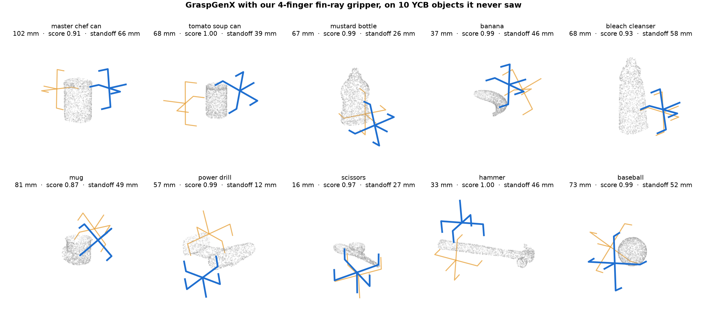

# Stage 2 — where to grasp

**object point cloud + chosen gripper → GraspGenX → 6-DOF grasps**

GraspGenX conditions on a **swept-volume box**: twelve numbers describing the space
between the fingers when open and half-closed. Ours are measured from the STLs and live in
`gripper/gripper_params_measured.json`.

| notebook | gripper |
|---|---|
| `stage2_grasp.ipynb` | 2-finger, on 10 YCB objects outside GraspGenX's training set |
| `stage2_grasp_4finger.ipynb` | 4-finger, same objects |

## The result

**It works for the 2-finger gripper and not the 4-finger one.**

| | grasps reaching the object | median standoff |
|---|---|---|
| 2-finger | **84%** | −10 mm |
| 4-finger | **0%**, on every object | +28 mm |

*Standoff is how far past the fingertips the object begins: zero or less means the fingers
reach it, positive means the gripper stopped short and would close on air.*

The cause is the interface, not the objects. Our 2-finger swept box is 148 × 30 × 38 mm;
the 4-finger version is 148 × **148** × 38 mm, because the second pair closes along the
other axis. Nothing in those twelve numbers says "four fingers" — a square box reads as a
much bulkier gripper, so the model backs the pose off to keep the object clear of it. Same
fingers, same objects; the only input that changed is one extent.

And it gives no sign of the failure: confidences run up to 1.00 for grasps that land tens
of millimetres short. Confidence is a learned ranking score from the discriminator head,
with no geometry check behind it — which is why every number above comes from our own
measurement of the returned poses, not from the model.

## Objects

Ten YCB objects: master chef can, tomato soup can, mustard bottle, banana, bleach cleanser,
mug, power drill, scissors, hammer, baseball. YCB is a separate real-scanned benchmark and
GraspGenX indexes Objaverse by UUID, so the sets are disjoint — the notebooks check it
rather than assume it.

## Caveat

Standoff is geometry, not simulated grasping. It is enough to rule these grasps out, but a
standoff at or below zero would still not prove a grasp holds. GraspGenX's own simulation
extra is CUDA-only and will not run on this machine.
