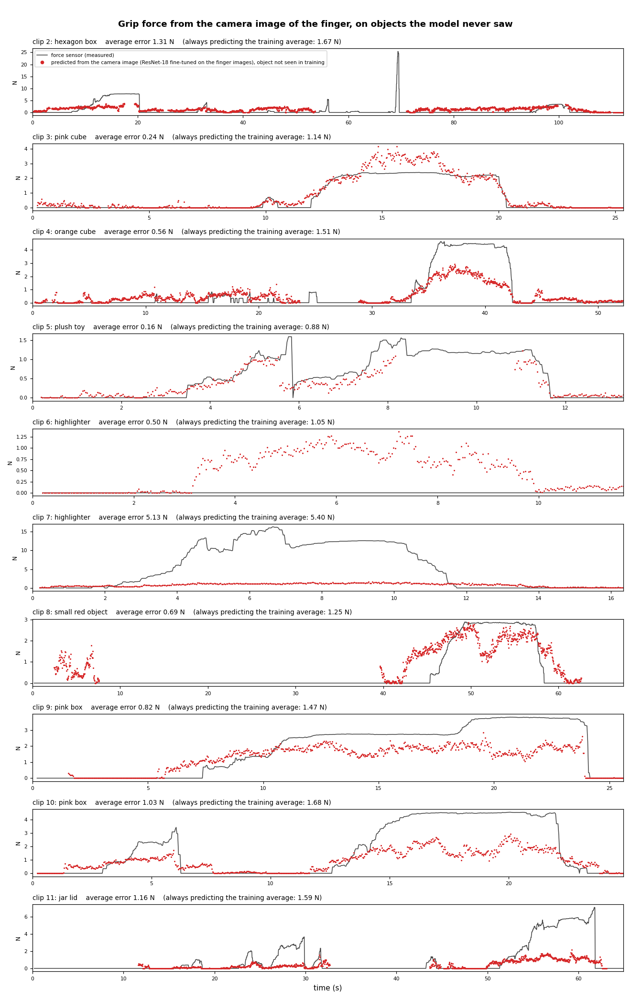

# Stage 3 — grip force from the finger

**screen recordings of the gripper camera + SEN0704 tactile grid → calibrated force per frame + finger shape → force model**

The data is 10 screen recordings in `data/forceSensor/`, clips 2–11, numbered by file name.
Clip 1, a red bottle filmed side-on with the camera flat on the table, was dropped because
every other clip looks down on the gripper. Each recording shows the gripper camera on the left and DFRobot's
Tactile Sensor Tool on the right, displaying the SEN0704 as a 6×6 grid of raw counts. Six
yellow-green markers sit on the fin-ray finger's contact beam, and the sensor film is on
the same beam. The gripper is hand-held and closed by hand.

| script | does |
|---|---|
| `calibrate.py` | known weights → grid sum. `F[N] = 0.00208·sum + 0.323`, R² 0.999 (15 of 17 points; 48.2 g and 484 g dropped as outliers) |
| `crop.py` | each recording → `crops/clipNN_gripper.mp4` + `crops/clipNN_sensor.mp4`, every frame kept, sensor crop lossless. Boxes in `crops/layout.json`, checked in `results/crops.png` |
| `grid_reader.py` | reads the 36 numbers. The GUI font has fixed-width digits (12 px tall, 9 px pitch) centred in each cell, so a cell is matched as 1–4 slots against `digit_templates.json`; nothing is segmented |
| `extract.py` | one row per frame → `data/forceSensor/frames.csv`, check videos in `data/forceSensor/qc/`, `results/clip_summary.csv`, `results/grasps.csv`, `results/clips.png` |
| `force_model.py` | force from the marker shape alone, scored with each object held out → `results/force_model_metrics.csv`, `results/force_from_markers.png` |

```bash
python stage3_force/scripts/calibrate.py
python stage3_force/scripts/crop.py        # ~40 s
python stage3_force/scripts/extract.py     # ~40 s  (--from-csv: rebuild results/ only)
python stage3_force/scripts/force_model.py
```

## The data

**12,420 frames, 26 grasps on 8 objects, force 0–25 N.**


- **Sensor reading.** Every cell of every frame was read; none were left unreadable. On
  1,310 sampled non-zero cells the reader agreed with tesseract except in 26 cells. Checked
  by eye, tesseract was the one that was wrong in all 26, usually by dropping a narrow "1"
  (17 → 7, 153 → 3).
- **Markers.** All six were found in 69% of frames, and in 86% of frames where the finger
  is in contact. The misses are mostly real: the finger out of frame (clips 8 and 11 start
  without it), or a hand or the plush toy covering it. Overexposed markers, mostly in clip
  2, are recovered by a second, looser colour pass that is only accepted when it completes an
  evenly spaced chain.
- **Clip 6 never touches the sensor.** It is still useful as no-contact data.
- **Clip 2's 25 N spike** is above the heaviest calibration weight (1.7 kg, 16.8 N), so that
  value is extrapolated.
- **The camera image lags the sensor GUI by about 0.2 s** (6 frames), probably camera
  preview latency. `force_model.py` corrects for it.

## Force from the image of the finger (current approach)

The six markers only describe the contact beam's shape. When a flat object pushes the beam back
without bending it, the chain moves as a whole and its shape does not change. That movement is
visible in the image relative to the clamp the finger is mounted on, so the image models below look
at the whole finger instead of six points.

| script | does |
|---|---|
| `finger_crops.py` | a 224 px square around the marked finger in every frame, following the tracked markers: centred just past the middle of the chain towards the base, 2.4 chain lengths wide, turned so the fingertip is always at the top. It shows the contact beam, ribs, back beam, clamp, the other finger and the object (`results/finger_crops.png`). Frames more than 15 frames from a marker detection are not used |
| `force_vision.py` | frozen **DINOv2** (ViT-B/14 with registers) features per crop, then three heads scored leaving one object out: the training mean, **ridge** on a 256-component PCA of one frame, and a small causal **temporal CNN** over the last second |
| `force_finetune.py` | an ImageNet **ResNet-18 fine-tuned end to end** on the crops, strong colour augmentation, same folds |

Why these models. DINOv2-style self-supervised features beat end-to-end training when labels are
scarce (Sparsh, CoRL 2024), and in the closest prior work an end-to-end ResNet-50 + transformer
generalised poorly to an unseen object (Zuo et al., RA-L 2026, `papers/`). Camera-based force
estimators for compliant grippers otherwise fine-tune CNNs end to end (VFTS, IROS 2023; Forces for
Free, Sci. Robotics 2025, which adds memory over time), hence the fine-tuned ResNet-18 and the
temporal head. On this data the fine-tuned network won.

**A ResNet-18 fine-tuned on the finger images is the best model.** On objects it never saw it cuts
the error by a third, and it is the first model to beat the training average while the finger is in
contact. Same 8,510 frames as the marker model (all six markers seen), mean absolute error:

| model, object held out | all frames | in contact | Spearman | contact AUC |
|---|---|---|---|---|
| predict the training average | 1.70 N | 2.46 N | | |
| marker shape, gradient boosting (`force_model.py`) | 1.75 N | | | |
| frozen DINOv2 + ridge | 1.47 N | 2.53 N | 0.30 | 0.68 |
| frozen DINOv2 + temporal CNN | 1.58 N | 2.44 N | 0.17 | 0.59 |
| **ResNet-18, fine-tuned** | **1.14 N** | **2.17 N** | **0.60** | **0.85** |

Per held-out object, all 9,475 usable crops (in contact in brackets, against the training average's):

| object | training average | frozen DINOv2 + ridge | **fine-tuned ResNet-18** | Spearman, fine-tuned |
|---|---|---|---|---|
| plush toy | 0.88 N | 4.57 N | **0.16 N** (0.30 vs 0.40) | 0.89 |
| pink cube | 1.14 N | 0.28 N | **0.24 N** (0.50 vs 0.87) | 0.86 |
| orange cube | 1.51 N | 1.08 N | **0.56 N** (1.67 vs 2.19) | 0.73 |
| small red object | 1.25 N | 0.90 N | **0.69 N** (0.65 vs 1.28) | 0.77 |
| pink box | 1.58 N | 1.15 N | **0.93 N** (1.38 vs 1.86) | 0.84 |
| jar lid | 1.59 N | 1.35 N | **1.16 N** (2.37 vs 2.08) | 0.75 |
| hexagon box | 1.67 N | 1.47 N | **1.31 N** (2.26 vs 2.78) | 0.59 |
| highlighter | 3.59 N | **3.13 N** | 3.21 N (8.44 vs 8.50) | 0.67 |



- **It follows the force curve on every object** (Spearman 0.59–0.89), including the plush toy,
  which the frozen features read as a large force because the toy covers the finger.
- **It reads low above about 3 N**: about 2.5 N for the orange cube's 4.5 N, about 2 N for the pink
  box's 3.8–4.5 N, about 1.5 N for the jar lid's 6 N. The highlighter's 10–16 N is outside anything
  it was trained on; every other object stays under 8 N (bar clip 2's spike).
- **Clip 6**, the highlighter that never touches the sensor, gets 0.5–1.2 N for about 7 s while the
  highlighter sits against the finger. Either it presses the finger beside the sensor pad, which the
  sensor cannot see, or the network reacts to the object being there.
- Training: every 2nd frame, 8 epochs per fold, Huber loss, AdamW with a one-cycle schedule, colour
  jitter and channel shuffles, small rotations and shifts, random erasing; about 30 s per epoch on
  the M4 GPU, 35 min for all 8 folds.
- The frozen DINOv2 + ridge predictions are in `results/force_vision.png`. Subtracting a reference
  from each clip's first 30 usable frames ("taring") lowered the frozen model's error to 1.27 N but
  hurt the pink cube, so it is not used.

```bash
python stage3_force/scripts/finger_crops.py            # ~10 s
python stage3_force/scripts/force_vision.py features   # ~5 min on the M4 GPU (MPS output checked against CPU)
python stage3_force/scripts/force_vision.py heads      # ~3 min
python stage3_force/scripts/force_finetune.py          # ~35 min on the M4 GPU, resumable per fold
```

## Force from the marker shape (`force_model.py`, first attempt)

**Within a grasp, finger shape tracks force when the object bends the beam. Across
objects, it does not yet beat predicting the average.**

| | held out by object, MAE |
|---|---|
| predict the training mean | 1.72 N |
| ridge regression on shape features | 2.06 N |
| gradient boosting on shape features | 1.75 N |


The features are measured against the finger's resting shape in the same clip, after
removing translation, rotation and scale (the gripper moves around the image). They
include Procrustes distance, turning angles, sagitta and chord length.

**Why it doesn't generalise yet:**

1. **Flat faces don't bend the beam.** Against the cube corners and the plush toy, the beam
   curves and deformation follows force: in-clip R² 0.92 (pink cube), 0.87 (orange cube),
   0.65 (plush toy). Against the pink box, the highlighter, the jar lid and the small
   object, the beam is pushed back but stays nearly straight. Deformation stays around 1%
   of finger length even at 3–16 N, with R² 0.07–0.22.
2. **Pushing the beam back is invisible to these features.** All six markers are on the
   moving beam and the gripper moves in the image, so there is no fixed point to measure
   displacement against.
3. **The sensor sees only the force through its pad.** The two cubes bend the finger by the
   same ~4%, yet read 2.4 N and 4.5 N, depending on how much of the contact lands on the
   film.

## What would fix it

- **Two or three markers on the rigid base or palm.** The beam's displacement relative to
  them captures flat contacts that shape alone misses.
- **A camera fixed to the gripper,** so that perspective is the same across clips.
- **Log the sensor over serial** (COM9, 115200 baud) with timestamps, instead of
  screen-recording the GUI. That removes the 0.2 s lag and the digit reading.
- **Repeat each object 5–10 times,** with the contact centred on the pad. Several grasps per
  object also allow scoring held-out grasps instead of only held-out objects.
