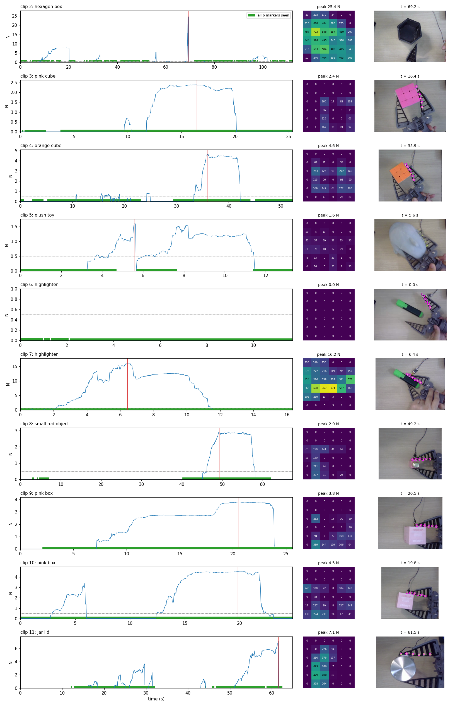
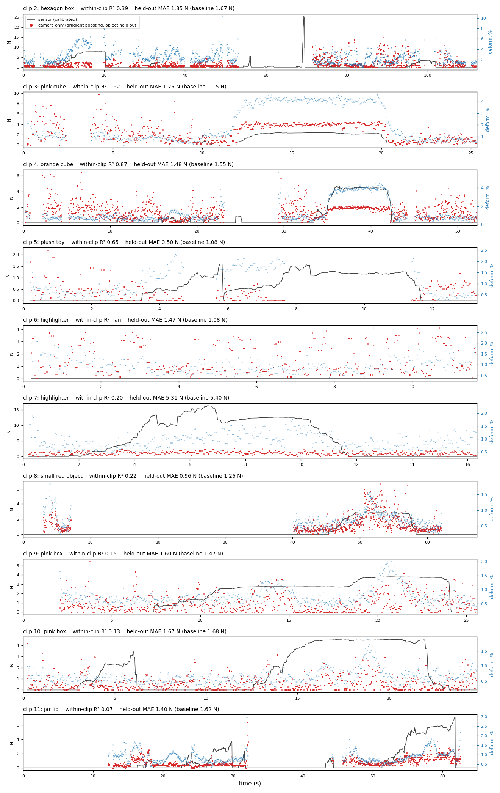

# Stage 3 — grip force from the finger

**screen recordings of the gripper camera + SEN0704 tactile grid → calibrated force per frame + finger shape → force model**

The data is 10 screen recordings in `data/forceSensor/`, clips 2–11, numbered by file name.
Clip 1, a red bottle filmed side-on with the camera flat on the table, was dropped because
every other clip looks down on the gripper. Each recording shows the gripper camera on the left and DFRobot's
Tactile Sensor Tool on the right, displaying the SEN0704 as a 6×6 grid of raw counts. Six
yellow-green markers sit on the fin-ray finger's contact beam, and the sensor film is on
the same beam. The gripper is hand-held and closed by hand.

| script | does |
|---|---|
| `calibrate.py` | known weights → grid sum. `F[N] = 0.00208·sum + 0.323`, R² 0.999 (15 of 17 points; 48.2 g and 484 g dropped as outliers) |
| `crop.py` | each recording → `crops/clipNN_gripper.mp4` + `crops/clipNN_sensor.mp4`, every frame kept, sensor crop lossless. Boxes in `crops/layout.json`, checked in `results/crops.png` |
| `grid_reader.py` | reads the 36 numbers. The GUI font has fixed-width digits (12 px tall, 9 px pitch) centred in each cell, so a cell is matched as 1–4 slots against `digit_templates.json`; nothing is segmented |
| `extract.py` | one row per frame → `data/forceSensor/frames.csv`, check videos in `data/forceSensor/qc/`, `results/clip_summary.csv`, `results/grasps.csv`, `results/clips.png` |
| `force_model.py` | force from the marker shape alone, scored with each object held out → `results/force_model_metrics.csv`, `results/force_from_markers.png` |

```bash
python stage3_force/scripts/calibrate.py
python stage3_force/scripts/crop.py        # ~40 s
python stage3_force/scripts/extract.py     # ~40 s  (--from-csv: rebuild results/ only)
python stage3_force/scripts/force_model.py
```

## The data

**12,420 frames, 26 grasps on 8 objects, force 0–25 N.**



- **Sensor reading.** Every cell of every frame was read; none were left unreadable. On
  1,310 sampled non-zero cells the reader agreed with tesseract except in 26 cells. Checked
  by eye, tesseract was the one that was wrong in all 26, usually by dropping a narrow "1"
  (17 → 7, 153 → 3).
- **Markers.** All six were found in 69% of frames, and in 86% of frames where the finger
  is in contact. The misses are mostly real: the finger out of frame (clips 8 and 11 start
  without it), or a hand or the plush toy covering it. Overexposed markers, mostly in clip
  2, are recovered by a second, looser colour pass that is only accepted when it completes an
  evenly spaced chain.
- **Clip 6 never touches the sensor.** It is still useful as no-contact data.
- **Clip 2's 25 N spike** is above the heaviest calibration weight (1.7 kg, 16.8 N), so that
  value is extrapolated.
- **The camera image lags the sensor GUI by about 0.2 s** (6 frames), probably camera
  preview latency. `force_model.py` corrects for it.

## The force model

**Within a grasp, finger shape tracks force when the object bends the beam. Across
objects, it does not yet beat predicting the average.**

| | held out by object, MAE |
|---|---|
| predict the training mean | 1.72 N |
| ridge regression on shape features | 2.06 N |
| gradient boosting on shape features | 1.75 N |



The features are measured against the finger's resting shape in the same clip, after
removing translation, rotation and scale (the gripper moves around the image). They
include Procrustes distance, turning angles, sagitta and chord length.

**Why it doesn't generalise yet:**

1. **Flat faces don't bend the beam.** Against the cube corners and the plush toy, the beam
   curves and deformation follows force: in-clip R² 0.92 (pink cube), 0.87 (orange cube),
   0.65 (plush toy). Against the pink box, the highlighter, the jar lid and the small
   object, the beam is pushed back but stays nearly straight. Deformation stays around 1%
   of finger length even at 3–16 N, with R² 0.07–0.22.
2. **Pushing the beam back is invisible to these features.** All six markers are on the
   moving beam and the gripper moves in the image, so there is no fixed point to measure
   displacement against.
3. **The sensor sees only the force through its pad.** The two cubes bend the finger by the
   same ~4%, yet read 2.4 N and 4.5 N, depending on how much of the contact lands on the
   film.

## What would fix it

- **Two or three markers on the rigid base or palm.** The beam's displacement relative to
  them captures flat contacts that shape alone misses.
- **A camera fixed to the gripper,** so that perspective is the same across clips.
- **Log the sensor over serial** (COM9, 115200 baud) with timestamps, instead of
  screen-recording the GUI. That removes the 0.2 s lag and the digit reading.
- **Repeat each object 5–10 times,** with the contact centred on the pad. Several grasps per
  object also allow scoring held-out grasps instead of only held-out objects.
